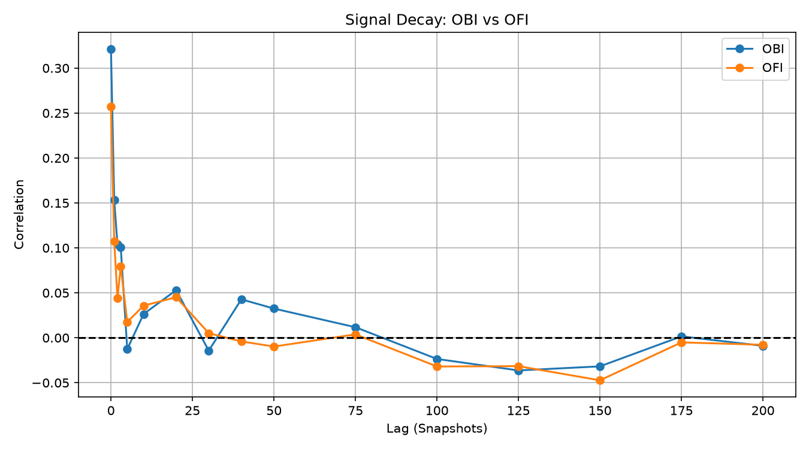
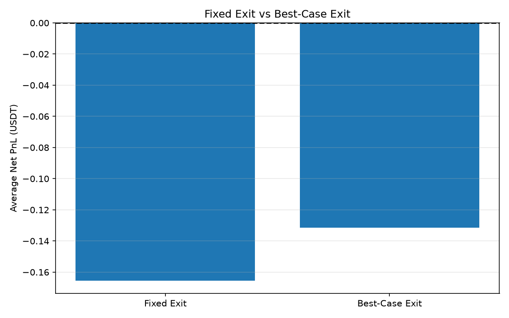

# BTCUSDT Market Microstructure Research

### Order Book Imbalance, Short-Term Price Predictability & Transaction Costs

## Overview

This project investigates whether order book imbalance (OBI) contains predictive information about short-term BTCUSDT price movements and whether this information can be translated into profitable trading strategies after transaction costs.

The research was conducted using Python and Binance REST API order book snapshots.

**Central research question:** Can statistically informative order book signals generate an economically viable trading edge after bid-ask spreads and trading fees?

## Methodology

The research includes:

- Collection of BTCUSDT order book snapshots using the Binance REST API.
- Feature engineering: Order Book Imbalance (OBI), approximate Order Flow Imbalance (OFI), bid-ask spread, midprice and microprice.
- Signal decay analysis across multiple snapshot horizons.
- Evaluation of OBI signal strength and subsequent directional price movements.
- Event-based backtesting with non-overlapping positions.
- Transaction cost analysis using an assumed 0.10% taker fee per side.
- Out-of-sample evaluation and retrospective best-case exit analysis.

## Out-of-Sample Results

The final evaluation used **2,000 order book snapshots**, collected on October 21, 2026, with an average interval of approximately 1.023 seconds.

The selected strategy entered when OBI crossed above +0.95 or below -0.95, then exited after 30 snapshot intervals.

| Metric | Fixed Exit | Best-Case Exit |
|---|---:|---:|
| Number of trades | 50 | 50 |
| Average directional price movement | +3.16 USDT | +37.08 USDT |
| Average net PnL per trade | -0.165411 USDT | -0.131483 USDT |
| Net profitable trades | 1 / 50 | 1 / 50 |

The best-case exit selects the most favorable observed bid or ask quote within each trade's 30-snapshot holding window. It is a retrospective, non-tradable benchmark rather than an executable strategy.

Even under this favorable assumption, **49 of 50 trades failed to overcome the modeled transaction costs**.


## Signal Decay Analysis

The analysis examines how the relationship between current
Order Book Imbalance (OBI) and subsequent midprice changes
evolves across different snapshot lags.



The results suggest that the short-horizon predictive
relationship weakens as the lag increases.

The chart represents an exploratory sample and should not
be interpreted as evidence of a consistently profitable
trading signal.


## Fixed Exit vs Best-Case Exit

To investigate whether poor exit timing was responsible
for the negative trading results, I compared a fixed
30-snapshot exit with an oracle-based best-case exit.



### Key Results

- **Fixed Exit Average Net PnL:** -0.165411 USDT
- **Best-Case Average Net PnL:** -0.131483 USDT
- **Number of trades:** 50
- **Best-Case Unprofitable Trades:** 49 out of 50

Even when selecting the most favorable observed exit
quote within each holding window, 98% of trades
failed to overcome the assumed transaction costs.

The best-case exit uses future price information and
is therefore a retrospective benchmark, not an
executable trading strategy.


## Key Finding

**Statistical predictability does not necessarily imply economic profitability.**

Although order book imbalance showed positive short-horizon relationships with subsequent price changes in parts of the analysis, the observed movements were generally insufficient to overcome the assumed trading costs.

The out-of-sample results also demonstrated that strong OBI signals did not consistently produce large subsequent price movements.

## Limitations

- REST snapshots do not capture every intermediate order book update.
- The evaluation covers a relatively short market period.
- The simplified backtest does not fully model execution latency, slippage or market impact.
- Simulated short positions are not directly executable through a standard spot-only account.
- Multiple exploratory parameter choices introduce a risk of overfitting.
- The best-case exit analysis assumes hindsight knowledge of future observed quotes.

## Technology

Python, Pandas, NumPy-compatible numerical analysis, Matplotlib, Requests, CSV and Binance REST API.

## Project Status

Research and exploratory validation completed. The strategy is **not intended for live trading**.

The code and findings are provided for educational and research purposes.


## Installation & Usage

### 1. Clone the Repository

```bash
git clone https://github.com/berkant1863-netizen/btcusdt-market-microstructure-project.git
cd btcusdt-market-microstructure-project
```

### 2. Install Dependencies

Python 3 is required.

```bash
python3 -m pip install -r requirements.txt
```

### 3. Configure Data Collection

Open `market_microstructure.py` and update the settings:

```python
COLLECT_NEW_DATA = True
CSV_FILE = "orderbook_data.csv"
SNAPSHOT_COUNT = 2000
```

Setting `COLLECT_NEW_DATA = True` collects new BTCUSDT order book snapshots using the Binance REST API.

**Warning:** Data collection opens the selected CSV file in write mode and overwrites an existing file with the same name.

### 4. Run the Research

```bash
python3 market_microstructure.py
```

The script collects data and runs the research analyses.

After collecting data, change:

```python
COLLECT_NEW_DATA = False
```

Run the script again to analyze the existing CSV without collecting new data.

### 5. Data Availability

Raw market data CSV files are not included in this repository.

Users can collect their own BTCUSDT order book snapshots using the data collection functionality.

Results may differ depending on market conditions, API latency, and sampling intervals.

### 6. Research Outputs

The project includes:

- Order book feature calculations
- OBI and OFI correlation analysis
- Signal decay analysis
- Trading strategy backtests
- Transaction cost analysis
- OBI strength and entry-event analysis
- Fixed-exit and best-case-exit comparisons
- Data quality and backtest validation

Selected research figures are available in the `figures/` directory.

